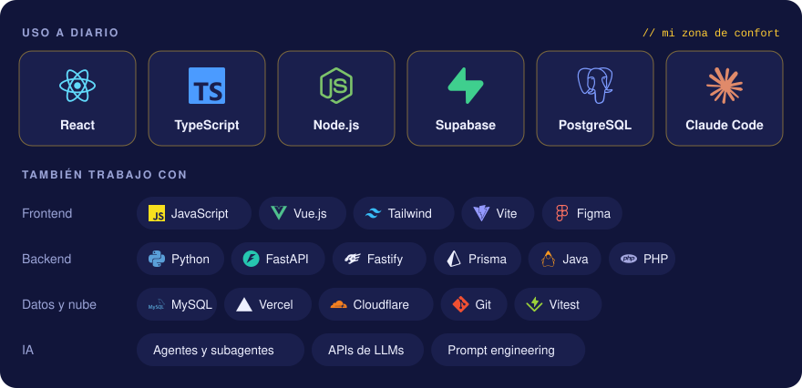

<div align="center">
  
</div>

### Hola, soy Alejandro 👋

Estudiante de Ingeniería de Computación en la **UJAP** (9no semestre) y desarrollador **fullstack**. Me gusta el software que sale del aula y lo usa gente real: un dashboard para una alcaldía, una tienda que vende de verdad y la app de un almacén de vidrio.

Diseño en Figma, programo frontend y backend, y trabajo con agentes de IA como parte de mi día a día. Hablo inglés con fluidez.

```ts
const alejandro = {
  base: "Valencia, Carabobo 🇻🇪",
  rol: "Fullstack dev · Ing. de Computación @ UJAP",
  diaADia: ["React", "TypeScript", "Supabase", "PostgreSQL"],
  superpoder: "pasar de 'tengo una idea' a 'ya está desplegado'",
  bugs: "features sin documentar (trabajando en ello)",
  buscando: "mi primer equipo de desarrollo",
};
```



## Lo que he construido para clientes reales

**Dashboard de analíticas e inclusión social** · Alcaldía de San Diego  
Procesa y segmenta **más de 15.000 registros demográficos**. Server Components para no mandar a la red lo que el servidor puede resolver.  
`React` `TypeScript` `Prisma` · <sub>código institucional, privado</sub>

**Aura, tienda en línea con panel propio** · [theauraaweb.com](https://theauraaweb.com/)  
E-commerce hecho desde cero para un negocio real de moda y accesorios, con un panel donde el dueño maneja catálogo, temas y precios en bolívares con la tasa del BCV.  
`React` `Tailwind` `Supabase` `PostgreSQL`

**Repiauto, mi trabajo de grado** · gestión de almacén  
App para un almacén real de vidrio automotriz: pedidos a China, contenedores, cajas, ubicaciones y un portal mayorista que muestra precios sin revelar el stock interno. 21 migraciones SQL y registro de actividad con triggers.  
`React 19` `TypeScript` `Supabase` `Vercel` `Vitest` · <sub>[versión original en FastAPI](https://github.com/Alejandro-Santos7/Repiauto)</sub>

## Y otras cosas que me divirtió construir

| Proyecto | Por qué vale la pena |
|---|---|
| **[Venezuela Te Busca](https://venezuelateayuda.com/)** | Registro público para localizar personas tras el sismo de 2026. Colaboré en el equipo. React Router 7 sobre Cloudflare Workers, D1 y R2. |
| **Ventas Insights** | Claude redacta los reportes de ventas y **cada cifra se valida** contra los datos calculados. Si la IA se inventa un número, no pasa. Incluye pronóstico con backtesting. |
| **GestureFlow** | Mover el cursor de Windows con gestos de la mano, pensado para personas con movilidad reducida. C++, Win32 y MediaPipe. En desarrollo. |
| **Hexland Settlers** | Un juego tipo Catan multijugador en tiempo real con WebSockets. Ahora las peleas por las ovejas también tienen latencia. |
| **[Sistema operativo simulado](https://github.com/Alejandro-Santos7/sistema_operativo_sim)** | Un "SO" con sus apps en tres versiones: escritorio (Electron), web (React) y [Android](https://github.com/Alejandro-Santos7/so-movil-android) (Kotlin). Trae Snake, porque todo SO serio lo necesita. |

## Hablemos

[Portafolio](https://alejandro-lopez-santos.vercel.app) · [alejandro.lopez070605@gmail.com](mailto:alejandro.lopez070605@gmail.com)

<details>
<summary><b>In English</b></summary>
<br>

Computer Engineering student at UJAP (Venezuela) and fullstack developer. I build real systems for real clients: an analytics dashboard for the San Diego Mayor's Office (15,000+ records), a live e-commerce store with its own admin panel ([theauraaweb.com](https://theauraaweb.com/)), and Repiauto, a warehouse app for a real auto glass warehouse (my thesis). Daily stack: React, TypeScript, Node.js, Supabase and PostgreSQL, with AI agents in my workflow. Fluent in English and looking for my first development team.

</details>

<sub>Si llegaste hasta aquí, ya casi somos compañeros de equipo. Escríbeme.</sub>
